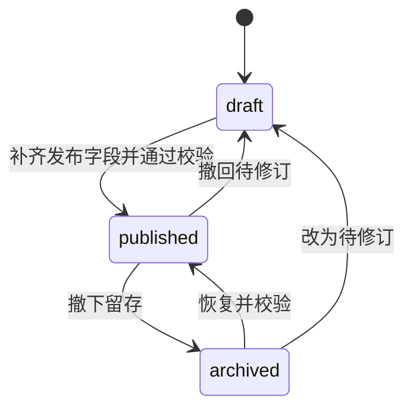

# 博客 v1 内容模型与公开数据契约

- 版本：1.0，2026-11-14；任务 METI-3；依赖已验收 ADR 0001 与 METI-7。
- 本文定义必须满足的数据行为，不指定 Dev1 的函数名或校验库实现。全部输入来自 Git，构建期完成校验；无运行时 API、数据库或 CMS。
- 规格提交供 PM 验收；视觉映射审批见 `docs/design-spec.md`。本文不授予下游开工许可。

## 1. 存储与基础类型

| 文件 | 形式 | 内容 |
| --- | --- | --- |
| `content/posts/<slug>.md` | UTF-8，YAML frontmatter + Markdown | 一文件一文章；文件名不含额外的日期前缀 |
| `content/authors.json` | `Author[]` | 作者注册表 |
| `content/tags.json` | `Tag[]` | 标签注册表 |
| `content/categories.json` | `Category[]` | 分类注册表；v1 可为 `[]` |
| `content/series.json` | `Series[]` | 系列注册表；v1 可为 `[]` |
| `content/site.json` | `Site` | 本站名称、介绍与默认 SEO |
| `content/about.md` | frontmatter + Markdown | 关于页单例，构建必需 |
| `public/content/` | 授权静态图片 | 被内容引用的本地资源；构建时不联网下载 |

基础定义：

- `Text(min,max)`：NFC Unicode 文本，按 Unicode code point 计长度；必须已去首尾空白，不得含换行、控制字符；不自动截断或悄悄纠正。Markdown 正文不适用单行限制。
- `Slug`：1–80 个 ASCII 字符，正则 `^[a-z0-9]+(?:-[a-z0-9]+)*$`；不得含 `/`、`.`、`_`、空格、百分号、Unicode 或连续/首尾 `-`。文件名与 frontmatter slug 完全一致。ID 也用此格式。
- `Date`：**字符串** `YYYY-MM-DD`，范围 `0001-01-01` 至 `9999-12-31`，必须为真实 Gregorian 日期；验证闰年，不接受 JS 自动滚动后的日期。YAML 必须将日期加引号，不能把自动解析的 Date 对象当字符串。
- `AssetPath`：以 `/content/` 开始的本站绝对路径，映射到 `public/content/` 的存在文件；仅允许 ASCII 字母、数字、`/`、`-`、`_`、`.`，禁止 `..` 路径段、空段、query、fragment、反斜线与编码路径。允许 PNG/JPEG/WebP/AVIF；不接受可执行 SVG 或远程图片 URL。
- 所有对象不接受未知字段；可选字段缺省是“未提供”，不接受 `null` 或空串充当缺省。空数组只在表格明确允许时有效。注册表即使为空也必须存在且为数组。

## 2. 文章 PostSource

frontmatter 字段如下；正文是分隔符之后的 Markdown，不另塞入 YAML。

| 字段 | 类型 | 必填 | 约束/用途 |
| --- | --- | --- | --- |
| `slug` | `Slug` | 是 | 全文章集合唯一，含 draft/archived；不可自动由标题转写 |
| `title` | `Text(1,100)` | 是 | 页面可见标题；不接受 HTML |
| `excerpt` | `Text(1,200)` | 是 | 列表摘要；不从正文盲截，便于确定性/安全输出 |
| `status` | `"draft" \| "published" \| "archived"` | 是 | 仅 published 可公开 |
| `publishedAt` | `Date` | 条件 | published/archived 必须；draft 可不填，也可保留原发布日期 |
| `updatedAt` | `Date` | 否 | 存在时必须同时有 publishedAt，且 `updatedAt >= publishedAt` |
| `authorId` | `Slug` | 是 | 精确指向一个 Author.id，不从自由文本猜作者 |
| `tagSlugs` | `Slug[]` | 是 | 0–10 个，无重复；每个指向 Tag.slug；展示顺序按此数组 |
| `categorySlug` | `Slug` | 否 | 精确指向 Category.slug；每篇至多一个 |
| `series` | `{ slug: Slug, order: integer }` | 否 | 指向 Series.slug；order 1–999；同系列 order 在所有状态文章间唯一，允许缺号 |
| `cover` | `Image` | 否 | 列表/文章封面；无封面时规则见视觉规范 |
| `seo` | `SEOOverride` | 否 | 单个覆盖对象；没有覆盖时可整体省略 |

正文去除空白后至少 1 个字符（所有状态均校验）。不允许正文 H1：页面 title 已是唯一 H1；正文 H2–H6 可用。分类/系列仅完成模型与引用校验，**v1 不增加分类页、系列页、切换器或系列前后篇导航**，不是新产品功能。

### 2.1 Image 与 SEOOverride

| 字段 | 类型/必填 | 规则 |
| --- | --- | --- |
| `Image.src` | `AssetPath`，是 | 图片文件存在，可解码 |
| `Image.alt` | `Text(1,200)`，是 | 内容含义描述，不能用文件名代替；封面不得标成装饰图 |
| `Image.width`、`Image.height` | 整数，各必填 | 各 1–10000，必须等于资源真实像素尺寸；用于防布局跳动 |
| `SEOOverride.title` | `Text(1,100)`，否 | 不含站点后缀；最终 HTML title 仍统一拼接站名 |
| `SEOOverride.description` | `Text(1,200)`，否 | 纯文本；不填则用 excerpt |
| `SEOOverride.ogImage` | `Image`，否 | 不填用 cover，再不填用 site.defaultOgImage |

提供 seo 对象时必须至少覆盖一个字段。`canonical` **是派生 SEO 字段，不是编辑器可覆盖的输入**：`SITE_URL + canonicalPath`；不允许跨域 canonical 或把发布文章 canonical 指向归档页。提交输入字段 `seo.canonical` 必须报未知字段错误。产出的 `PageSEO.canonical` 是完整绝对 URL。

## 3. 作者、标签、分类、系列与站点

| 实体 | 字段名与类型 | 约束 |
| --- | --- | --- |
| Author | `id: Slug`，`name: Text(1,60)`，`bio?: Text(1,300)`，`avatar?: Image`，`url?: string` | id 唯一；url 为无 userinfo 的 HTTPS 绝对 URL；不收集邮箱等私有信息 |
| Tag | `slug: Slug`，`name: Text(1,40)`，`description?: Text(1,200)` | slug 唯一；name NFC 后在本注册表唯一 |
| Category | `slug: Slug`，`name: Text(1,40)`，`description?: Text(1,200)` | 同 Tag；与标签是独立注册表，不建层级 |
| Series | `slug: Slug`，`title: Text(1,80)`，`description?: Text(1,200)` | slug/title 在本注册表各唯一；成员由 PostSource.series 反向关联，不维护第二份成员列表 |
| Site | `name: Text(1,40)`，`description: Text(1,200)`，`language: "zh-CN"`，`defaultAuthorId: Slug`，`defaultOgImage: Image` | 全必填；defaultAuthorId 必须存在；默认作者用于关于页，不填补文章缺失作者 |
| About frontmatter | `title: Text(1,100)`，`description: Text(1,200)`，`authorId: Slug`，`seo?: SEOOverride` | 前三者必填，作者引用必须存在；正文同文章规则；about 的 SEO description 缺省用 description |

作者名允许相同（身份靠 id 区分）。跨实体同 slug 不冲突；文章 slug 不占用标签 slug 命名空间。不生成作者详情页、分类页、系列页或标签索引页；这些未知路由均为 404。作者名在文章页展示为文字，只有明确填写 Author.url 时才可作为外链。

`SITE_URL` 是 ADR 定义的环境输入，不存入 site.json：本地缺省 `http://localhost:4321`；部署时必须显式使用获批的 HTTPS origin，无路径/query/fragment/userinfo；归一化去结尾 `/` 后参与 URL 拼接。不得发布 localhost 或参考站域名；不支持子路径部署。

## 4. 状态机与公开性



- 状态变化是 Git 编辑 + 完整重建，不是在线操作。v1 不提供状态按钮，也不检查 Git 历史强制迁移边：初次导入的合法 published/archived 文件可直接通过；状态图定义编辑语义。
- `archived` 是**非公开留存**，不是 `/archive` 的意思。`/archive` 仍只列 published。归档/撤回后原文章 URL 404，不返回 200 空壳、301 首页或“已归档”详情。
- draft 与 archived 的标题、摘要、作者关联、正文、SEO 均不得进入公开 HTML/内联 JSON/JS、RSS、sitemap、标签计数或公开数据 bundle。它们的输入错误仍必须阻断构建。
- 文章引用的资源也必须遵守发布过滤：仅被 draft/archived 使用的图片不能随公开产物复制。Dev1 负责资产输出校验；不应把整个内容资源目录无差别公开。若同一资源也被 published/关于页/站点默认图使用，则该共享资源允许公开。
- 不做定时发布；**只按 status 过滤，不读系统时钟**。publishedAt 为未来日期但显式 published 的文章仍公开，避免同一输入跨日期产物变化；这不是“预约发布”能力。
- slug 改动视为删除旧 URL、新建新 URL；v1 不维护重定向或别名。恢复发布使用原 slug 则恢复原 URL。

## 5. 排序、分页和 URL

公开集合先过滤 `status === "published"`，再按 `publishedAt` 降序；同日按 ASCII slug 升序。禁止按本地化标题、文件系统遍历顺序、updatedAt 或当前时间排序。首页取前 **6** 篇；归档页大小 **6**，标签页列出该标签全部公开文章，不新增标签分页。

| 页面/产物 | 规范路径 | 规则 |
| --- | --- | --- |
| 首页 | `/` | 最新 6 篇；末尾“全部文章”链接 `/archive`；没有首页分页 URL |
| 文章 | `/posts/<slug>` | published 才存在 |
| 归档第一页 | `/archive` | 不使用 `/archive/page/1` |
| 归档第 n 页 | `/archive/page/<n>` | n 为无前导零的十进制整数，且 `2 <= n <= totalPages` |
| 标签 | `/tags/<slug>` | Tag 存在且至少有一篇公开文章才生成 |
| 关于 | `/about` | 固定单例，必须存在 |
| XML | `/rss.xml`、`/sitemap.xml` | 固定文件名 |
| 未知 | 不生成成功页面 | 含 `/tags`、分类/作者/系列路径、私有文章、`.html` URL、非法页码等 |

- `totalPages = max(1, ceil(publishedCount / 6))`；第 n 页是有序集合索引 `[6*(n-1), min(6*n,count))`。空集合仍有首页/归档第一页 200，显示“暂无文章”；不存在第 2 页。已注册但没有公开文章的标签返回 404，不泄露私有标签内容。
- 例如 7 篇公开文章：第一页 6、第二页 1；共 6 篇时第二页 404。`/archive/page/0`、`/archive/page/1`、`/archive/page/02`、`/archive/page/-1`、`/archive/page/a`、超大整数及超出范围均 **404，不重定向**。
- 所有规范路径除根 `/` 外无尾 `/`、无扩展名，无 query/fragment。已存在公开路径的尾 `/` 变体必须以 **308** 去尾斜杠；根不改变。未存在路径的尾斜杠形式仍 404。`.html` 形式不作为外部成功 URL，返回 404；内部静态文件查找不应泄露为另一份成功路由。
- 查询参数不参与内容选择；已存在路径携 query 仍 200，canonical 去 query；fragment 是客户端定位，不纳入 canonical。百分号编码不允许用来伪造另一 slug；服务器遇非法编码返回 400 或 404，不能公开私有路径。内容索引不负责对未经解码的网络请求猜 slug。
- 主机须遵守 ADR 静态文件与 HTTP 契约；Dev2 文件路由和 Dev1 纯 URL 逻辑共享同一清单，不能依赖 Astro.url 中的 `.html`。
- 分页必须提供上一页、当前页/总页数、下一页；上一页在第一页、下一页在末页是非链接禁用文本，没有 href、不能被激活。第二页的上一页指向 `/archive`。每页 canonical 指向自身，不能全指第一页。

## 6. SEO 派生与发现性产物

每个公开成功 HTML 返回一个 `PageSEO`：`title: string`、`description: string`、`canonical: absolute URL`、`ogTitle: string`、`ogDescription: string`、`ogImage: absolute URL`、`ogImageAlt: string`、`ogType: "website" | "article"`、`language: "zh-CN"`。展示组件只消费已派生的对象，不二次拼接后缀。

| 页面 | HTML title / og:title | description | OG 图片 |
| --- | --- | --- | --- |
| 首页 | `首页 · {site.name}` | site.description | site.defaultOgImage |
| 文章 | `{seo.title 或 title} · {site.name}` | seo.description 或 excerpt | seo.ogImage → cover → site.defaultOgImage |
| 归档第 1 页 | `文章归档 · {site.name}` | `全部已发布文章，第 1 页，共 {totalPages} 页。` | site.defaultOgImage |
| 归档第 n 页 | `文章归档（第 {n} 页） · {site.name}` | `全部已发布文章，第 {n} 页，共 {totalPages} 页。` | site.defaultOgImage |
| 标签 | `标签：{tag.name} · {site.name}` | Tag.description；缺省 `收录“{tag.name}”标签下的 {count} 篇已发布文章。` | site.defaultOgImage |
| 关于 | `{about.seo.title 或 about.title} · {site.name}` | about.seo.description 或 about.description | about.seo.ogImage → site.defaultOgImage |

- 所有公开成功页面 title 必须**全局唯一**，即便是不同路由；最终组装后重复则构建失败，提示相关两个路由。description 可重用但非空。每页只输出一份 title、description、canonical 以及 OG 基础字段。
- `og:type` 仅文章页为 article，其他 website；og:title 与 HTML title 相同，og:description 与 description 相同；og:url 与 canonical 相同；og:image/alt/width/height 取完整 Image 的元数据。全站 HTML `lang="zh-CN"`、OG locale 为 `zh_CN`。
- 404 例外：`页面不存在 · {site.name}`、description `请求的页面不存在，请返回首页或文章归档。`、`robots=noindex,follow`；**不输出 canonical，不纳入成功页面 title 唯一集合**。可给相同标题的多个未知 URL 返回同一个 404，不为了 F7 伪造成功 canonical。
- RSS 只含全部 published，顺序同公开集合，不截成首页的 6 篇。每条 title 为文章原 title，description 为 excerpt 的 XML 转义纯文本，link/guid 为文章 canonical（guid 为永久链接），author 映射为可公开作者名而不是伪造邮箱；不输出邮箱格式的 RSS author 字段。pubDate 是 publishedAt 当日 **00:00:00 GMT** 的 RFC 822 表示；不读取生成时间。
- RSS channel 的 title/description/link/language 用 Site 与 SITE_URL；lastBuildDate 取公开文章 `updatedAt ?? publishedAt` 的最大日期，空集合省略；没有运行时 clock/generator 随机值。
- sitemap 按 canonicalPath ASCII 升序列出全部公开成功 HTML（含有效分页、标签、关于），不列 XML 本身、404、别名、draft/archived。文章 lastmod 用 updatedAt，否则 publishedAt；其余页面未定义可信更新时间，省略 lastmod，不伪造“今天”。

## 7. Markdown 与资源的安全边界

- 支持段落、H2–H6、无序/有序列表、引用、强调、链接、图片、行内与围栏代码。原始 HTML、script、iframe、事件属性、MDX 均拒绝；不要静默吞掉危险内容。
- 正文链接只接受 HTTPS 绝对 URL、本站以 `/` 开始的路径（不能 `//`）或当前文章 `#heading-id`。拒绝 javascript/data/vbscript/file 和其他协议。本站链接指向实际公开页面或合法公开资源；链接到草稿/archived、未知路径、失效锚点会构建失败。
- 不自动外链开新窗口。若 UI 确需 `target=_blank`，同时 `rel=noopener noreferrer` 并给出可读提示，不引入第三方埋点。
- 所有正文图片语法必须有非空 alt，且 src 为合法 AssetPath、文件存在。装饰图仅限 UI 自带图层并 aria-hidden，不用空 alt 绕过正文要求。
- 标题 ID：所有正文 H2–H6 必须使用显式尾部 `{#id}`，id 用 Slug，同一文章内唯一；该标记是内容约定，不显示为文本。渲染器须支持此约定；禁止依赖插件对中文标题的隐含转写。heading id 不得为 `main`（预留跳至正文）。仅定位功能，不要求新增目录组件。
- 图片、代码/长 URL 不撑开页面，视觉行为见 design-spec。v1 不承诺表格、脚注、数学公式或交互嵌入；输入出现未支持扩展语法必须报错，不让 Dev2 自行发明样式。

## 8. 页面消费契约（公共边界，不是实现接口名）

Dev1 在 `src/server` 提供经严格类型检查的等价数据入口，实际函数名可自行选择，但下列数据与语义不可变；Dev2 不接触私有 Source 集合。

| 对象/能力 | 必须提供的字段/结果 |
| --- | --- |
| PublicPostSummary | `slug,title,excerpt,publishedAt,updatedAt?,path,canonical,author:{id,name,url?},tags:[{slug,name,path}],cover?`；path 是 `/posts/<slug>`；不带 status 或私有源文件路径 |
| PublicPostDetail | Summary + `body`（安全可渲染正文，不预设字符串/AST 具体实现）+ `seo:PageSEO`；category/series 不进入 v1 页面消费对象 |
| Home | 已排序 `posts`（至多6）、`totalPublished`、`seo` |
| ArchivePage | `posts,page,pageSize:6,totalItems,totalPages,path,previousPath?:string,nextPath?:string,seo`；非法 page 为 not-found 结果，不以空列表替代 |
| TagPage | `tag:{slug,name,description?,path},posts,totalItems,seo`；未知/无公开文章的标签 not-found |
| About | `title,description,author,body,seo` |
| 路由/元信息 | 公开 path 清单、路径→SEO 一致映射、not-found 分支；HTML、RSS、sitemap 共用 |

`Image` 在公共对象中保留 src/alt/width/height，不把本地磁盘路径或构建私有字段序列化到浏览器。页面不通过数字 page 自行推断 URL，不重新过滤状态，不自行覆写排序。是否使用 Collections render 或安全 AST 属 Dev1/Dev2 的实现协作，不改变数据契约。

## 9. 完整原创示例（规范样例，不代表已安装内容）

以下是基于本项目已确认事实撰写的原创条目，非复制参考站文章。路径与图尺寸是 fixture 契约：Dev1 必须创建自有的对应图片并验证尺寸，否则不得声称样例已可构建；不构造虚假公网地址。所有可选字段均填充以展示结构，不要求生产条目全部填写。

`content/posts/blog-v1-design-contract.md`：

```yaml
---
slug: blog-v1-design-contract
title: 博客 v1 的内容与视觉契约
excerpt: 本项目用 Astro 静态输出和 Git 内 Markdown 管理内容，先固定字段、URL 与视觉规范，再进入实现和验收。
status: published
publishedAt: "2026-11-14"
updatedAt: "2026-11-14"
authorId: blog-team
tagSlugs:
  - architecture
  - design
categorySlug: project-notes
series:
  slug: building-blog-v1
  order: 1
cover:
  src: /content/blog-v1-design-contract/cover.png
  alt: 博客内容模型与视觉规范两份文档的示意图
  width: 1600
  height: 900
seo:
  title: 博客 v1：固定内容与视觉契约
  description: 记录博客 v1 采用的静态内容方式，以及 URL、发布状态和可访问性规范的边界。
  ogImage:
    src: /content/blog-v1-design-contract/og.png
    alt: 博客 v1 规格文档封面
    width: 1200
    height: 630
---
```

紧接 frontmatter 的正文：

```markdown
这个博客采用 Astro 静态输出，文章由 Git 内的 Markdown 文件管理。

## 先固定契约 {#contracts-first}

内容模型定义 slug、发布日期、作者和标签；视觉规范记录参考站 CSS 中实际取得的值。

## 再按规范验收 {#verify-contracts}

草稿不应出现在公开列表、RSS 或 sitemap。正文和交互文字需要满足对比度要求。

阅读[关于页](/about)可以了解项目介绍。
```

配套注册表与站点（分别写入相应 JSON 文件）：

```json
{
  "authors": [{"id":"blog-team","name":"博客项目组","bio":"负责本项目的规格、开发与验收。","avatar":{"src":"/content/authors/blog-team.png","alt":"博客项目组标识","width":256,"height":256},"url":"https://github.com/asmpg/multica-blog"}],
  "tags": [{"slug":"architecture","name":"架构","description":"内容模型与技术边界的记录。"},{"slug":"design","name":"设计","description":"视觉取证与界面规范的记录。"}],
  "categories": [{"slug":"project-notes","name":"项目记录","description":"博客 v1 的建设记录。"}],
  "series": [{"slug":"building-blog-v1","title":"建设博客 v1","description":"从规格到验收的项目记录。"}],
  "site": {"name":"博客 v1","description":"记录博客 v1 的内容、设计与建设过程。","language":"zh-CN","defaultAuthorId":"blog-team","defaultOgImage":{"src":"/content/site/og.png","alt":"博客 v1 站点标识","width":1200,"height":630}}
}
```

上方对象只是同时展示多个文件：`authors.json` 的根值是 authors 数组，不是含 authors 键的对象，其余注册表同理；`site.json` 的根值是 site 对象。`content/about.md` 用 `title: 关于`、`description: 介绍博客 v1 的建设目标。`、`authorId: blog-team` 和非空原创正文。

本地缺省 origin 下，该样例 path `/posts/blog-v1-design-contract`、canonical `http://localhost:4321/posts/blog-v1-design-contract`、最终 title `博客 v1：固定内容与视觉契约 · 博客 v1`、OG 图 `http://localhost:4321/content/blog-v1-design-contract/og.png`；RSS pubDate 为 `Sat, 14 Nov 2026 00:00:00 GMT`。这些本地值不能作为公网部署配置。

## 10. 必测边界与验收输入

- schema：缺 title/authorId/tagSlugs、错误类型、未知字段、重复 slug/标签、非法引用、空正文、非法图片/尺寸、seo.canonical 输入均非零失败；错误必须同时含条目文件或 ID、字段路径、原因。
- 日期：`2024-02-29` 通过，`2026-02-29`、`2026-13-01`、`2026-11-31`、无引号解析成 Date 对象均失败；updatedAt 早于 publishedAt 失败；draft 无 publishedAt 通过。
- 发布：至少 7 篇 published（含同日两篇）、1 篇 draft、1 篇 archived；fixture 同时覆盖有/无封面、空 tagSlugs、已注册仅私有文章使用的标签、两篇同日次序。
- 分页：0/1/6/7/12/13 篇公开文章的边界；集合不重复、不遗漏；空标签/未知标签、超范围页码返回真实 HTTP 404；已存在路径尾斜杠返回308。
- 安全：脚本/原始 HTML/危险协议、正文 H1、无 alt 图片、缺失资源、未知锚点构建失败；draft/archived 的独有图片与文字不会进入 dist。
- 元数据：枚举全部成功路由检查唯一 title、非空 description、OG 和准确 canonical；XML 可解析并转义 `& < >`；空集合不写虚构 lastmod；连续构建没有时钟差异。
- 本文提供的是测试要求，仓库当前无实现与测试命令可运行；具体执行命令仍依 ADR，由 Dev1 落地后给出证据。
